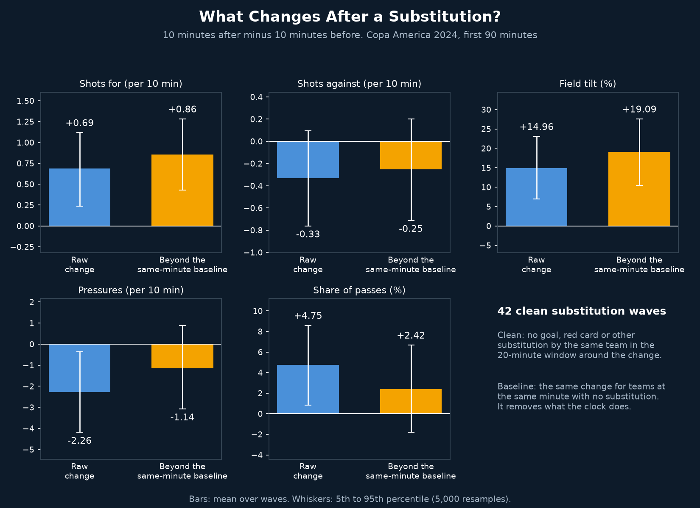
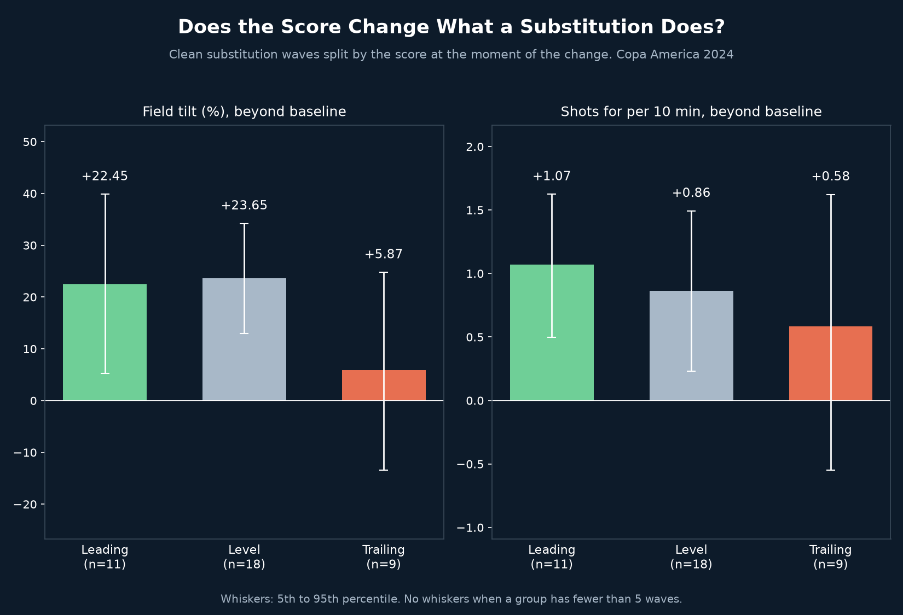

# Substitution Impact

## Why
A chart can show that teams change after a substitution, but the match clock moves at the same time: fatigue, the score and the opponent all change too. This project asks what changes after a substitution beyond what happens to other teams at the same minute with no substitution.

## What it does
- Finds every tactical substitution wave in the first 90 minutes of Copa America 2024 (changes within 2 minutes of each other count as one wave): 186 waves, 156 with a full 10 minutes before and after
- Measures the 10 minutes after minus the 10 minutes before for shots for, shots against, pressures, field tilt (share of final-third passes) and share of passes
- Keeps only clean waves: no goal, red card or other substitution by the same team in the 20-minute window (42 waves, 38 with a baseline)
- Builds a baseline from teams at the same minute (within 5 minutes) with no goal, red card or own substitution in the window, and subtracts it
- Splits the clean waves by the score at the moment of the change
- Replays Argentina vs Ecuador, measuring the 10 minutes before and after each Argentina wave as the clock runs

## Key findings

| Change after a clean wave (38 waves) | Raw change | Beyond the same-minute baseline (5th to 95th percentile) |
|---|---|---|
| Shots for (per 10 min) | +0.69 | +0.86 (+0.43 to +1.28) |
| Shots against (per 10 min) | -0.33 | -0.25 (-0.71 to +0.20) |
| Field tilt (%) | +14.96 | +19.09 (+10.47 to +27.59) |
| Pressures (per 10 min) | -2.26 | -1.14 (-3.08 to +0.89) |
| Share of passes (%) | +4.75 | +2.42 (-1.81 to +6.68) |

| Beyond baseline, by score at the change | Leading (11) | Level (18) | Trailing (9) |
|---|---|---|---|
| Field tilt (%) | +22.45 | +23.65 | +5.87 |
| Shots for (per 10 min) | +1.07 | +0.86 | +0.58 |

- Field tilt and shots for rose after a clean substitution, beyond what the clock does on its own. Shots against, pressures and share of passes stay inside the noise
- Leading and level teams gained far more field tilt than trailing teams, whose range includes zero. Trailing teams were already pushing forward
- The rise is probably not caused only by the substitution. Managers change when their team is struggling, so part of this is recovery after a low spell. This was not tested
- Argentina had 15 waves but only 3 clean, which is too few to say anything about them. In the replayed match, Argentina's field tilt was 11% before the 64' change and 62% after, which shows the low-point pattern

## Limitations
- 32 matches, 42 clean waves, 38 with a baseline, so the ranges are wide
- The baseline removes what the clock does, not what the manager saw before deciding to change
- The opponent's substitutions are not controlled
- Who came on and who went off is not used, only the timing
- Pressures depend on how long the opponent has the ball
- Field tilt is a share of final-third passes, not of time
- Extra time and shootouts are excluded

## Visual

*Raw change and change beyond the same-minute baseline for each measure. Whiskers show the 5th to 95th percentile.*

*Field tilt and shots for, beyond baseline, split by the score at the moment of the change.*

`substitution_replay.mp4` replays Argentina vs Ecuador and ends with both charts.

## Tools
Python, pandas, NumPy, matplotlib, imageio-ffmpeg

## Data source
StatsBomb open data, Copa America 2024 (32 matches). First 90 minutes only.
